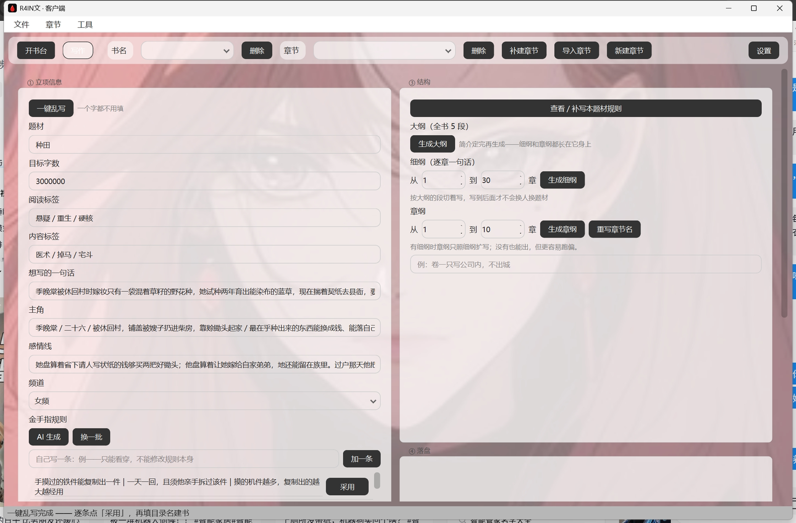

# R4INWEN · AI 小说写作工作台

一个用 PySide6 写的桌面写作工具。不替你写，帮你把一本长篇管住。

> 只做流程和档案管理，模型能力外购（自备 API Key）。

---

## 它解决什么问题

用 AI 聊天写小说，写到第 30 章你会遇到这些：

- 设定散在几十个对话里，翻不回来
- 人物前后性格不一致，名字叫法乱
- 上一章埋的钩子忘了接
- 每章都要重新交代一遍背景

R4INWEN 把这些变成**文件**：设定、人物库、章纲、正文各存一份，每次生成自动带上。

---

## 截图

开书台：一键乱写出整套立项，然后逐项点「采用」收进表单。



---

## 功能

**开书台**
- 一键乱写出整套立项（题材 / 标签 / 主角 / 感情线）
- 或导入已有的 `.md` 设定
- 金手指、钩子、书名、简介各出 4~6 个候选
- 大纲（5 段）→ 细纲（每章一句）→ 章纲（每章任务 + 钩子）

**写作台**
- 三栏：AI 稿 / 对话 / 你的定稿
- 生成正文分 4 段，自动清洗（去标题、去元信息、去重复段）
- 生成后自动查红线，问题处标黄底红波浪线
- 人物库自动更新（状态、称呼、能力）
- 导入已有章节，接着往下写

**红线检查**
- 禁用词、套话、车轱辘话
- 机器味结构：结尾反转句、数字太齐、视觉多于身体、「然后」式推进、全篇零阻力

---

## 安装

```bash
python -m venv .venv
.venv\Scripts\activate
pip install -r requirements.txt
```

需要 Python 3.10+。

---

## 配置

复制一份配置模板：

```bash
copy settings.example.json settings.json
```

然后填你的 API Key（DeepSeek / 豆包 / Kimi / 通义 / 智谱 都支持，走 OpenAI 兼容格式）。

```json
{
  "backend": "openai",
  "base_url": "https://api.deepseek.com",
  "model": "deepseek-chat",
  "api_key": "sk-你的key",
  "temperature": 0.9,
  "max_tokens": 8192,
  "context": 16000
}
```

启动：

```bash
python r4inwen.py
```

---

## 目录结构

```
books/<书名>/
  bible.md        设定
  characters.md   人物库
  outline.md      章纲
  skeleton.md     全书大纲
  beats.md        细纲
  chapters/       正文
  _bak/           覆盖前的旧版
corpus/
  rules.json      规则库
  train.jsonl     学习记录（可选）
```

---

## 两点说明

**关于质量**：生成质量取决于模型。7B 本地模型只能给初稿，需要你改。想要能直接发，得用更强的模型。

**关于 AI 检测**：本工具不承诺过 AI 检测。它的红线只能帮你找出结构上的机器味，最终还是要人改。

---

## 许可

MIT，见 LICENSE。
---

## 可以自己加强的部分

程序把提示词和题材规则都放在明处，方便你按自己的写法调整：

**① 题材规则** — `corpus/rules.json`

每个题材下有 hook / beat / trope / taboo / struct 五组，生成时会按当前书的题材取用。
仓库里给的是带示例的空结构，填上你自己的条目就会生效。

**② 生成提示词** — `launch.py`

`CHEAT_USER`（金手指）、`HOOK_USER`（钩子）、`TITLE_USER`（书名）、
`INTRO_USER`（简介）、`OUTLINE_USER`（章纲）、`SKELETON_USER`（大纲），
每个都是普通字符串常量，改成你习惯的要求即可。

**③ 写作守则** — `rules.py`

`WRITE_RULES` 是一段直接进系统提示词的文字。往里加你自己的规矩。

**④ 用自己写过的章节训练**

写作页点「学习」，会把你改定的章节存进 `corpus/train.jsonl`（Alpaca 格式）。
攒够量之后可以用 Unsloth 之类做一次 LoRA，让模型学会你的文风。

---

**生成质量最终取决于三件事**：模型本身、你给的章纲有多具体、上面这些约束调得多准。
开箱状态是「能跑的起点」，不是成品。
